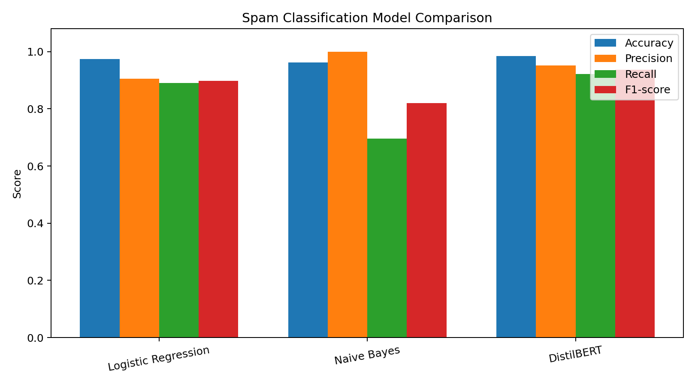
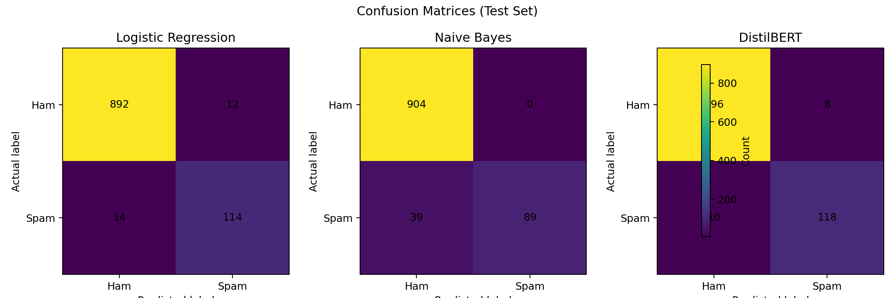
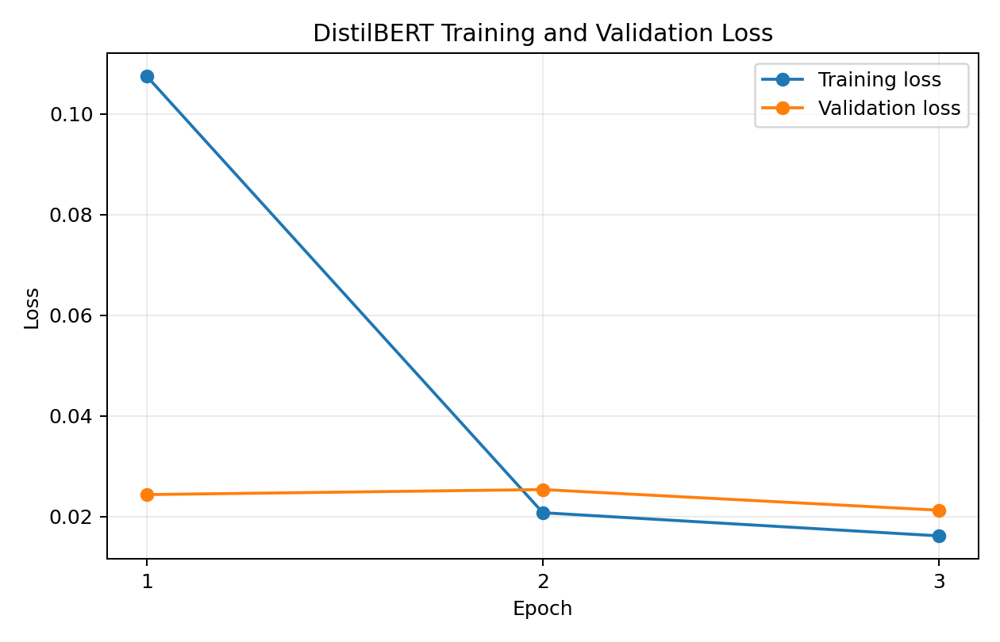
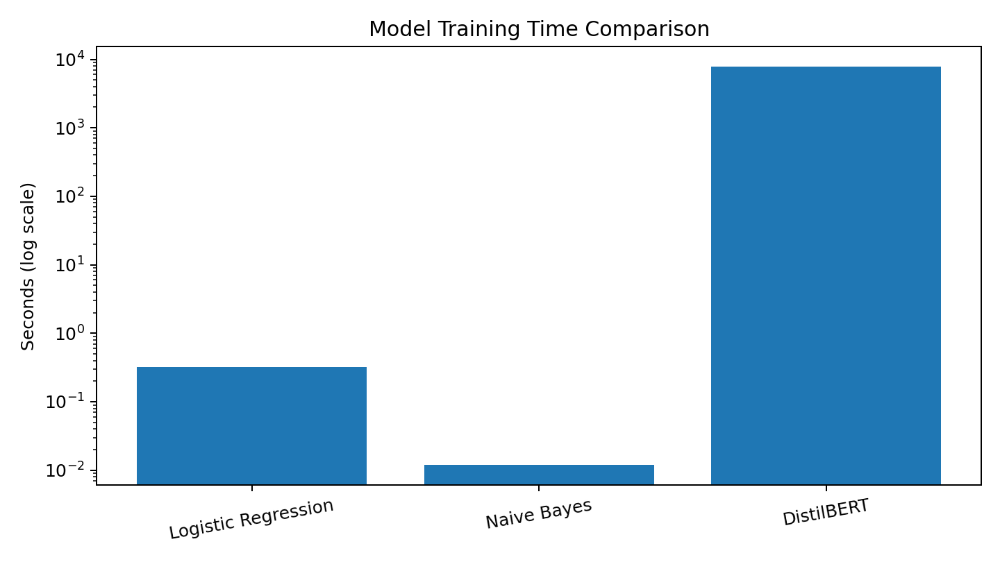

# Spam Classification: Traditional Machine Learning vs DistilBERT

**Author:** Tanuradha Sharma

## 1. Project Overview
This project compares traditional machine learning models and a transformer-based model to classify text messages as **Spam** or **Ham** (normal message).

The project uses:
- Logistic Regression
- Multinomial Naive Bayes
- DistilBERT fine-tuned with PyTorch

The models are evaluated on a held-out test set using accuracy, precision, recall, F1-score, confusion matrices, and training time.

> **Dataset note:** Although the file is named `email.csv`, the data mainly contains short, SMS-style messages. Therefore, results may not represent every type of full-length email.

## 2. Project Objectives
- Clean and prepare the message dataset.
- Convert text into numerical features using TF-IDF for traditional models.
- Train Logistic Regression and Naive Bayes classifiers.
- Fine-tune DistilBERT using a custom PyTorch training loop.
- Compare the models using evaluation metrics and visualizations.
- Test DistilBERT on new example messages.

## 3. Dataset
The notebook loads `email.csv`, which should contain these columns:
- `Category`: `spam` or `ham`
- `Message`: the text of the message

After cleaning invalid labels, empty messages, and duplicate rows, the project records **5,157 messages**:

| Category | Messages |
|---|---:|
| Ham | 4,516 |
| Spam | 641 |
| **Total** | **5,157** |

The dataset has more ham than spam messages, so the classes are imbalanced. Check the dataset's licence and permission before sharing the CSV publicly; the dataset is not included in this project bundle.

## 4. Methodology

### Traditional Machine Learning
1. Split the data into 80% training and 20% testing, using stratification and `random_state=42`.
2. Apply TF-IDF with English stop-word removal, up to 10,000 features, and unigram/bigram features.
3. Train Logistic Regression and Multinomial Naive Bayes.
4. Evaluate their predictions on the test set.

### DistilBERT
1. Load `distilbert-base-uncased` and its tokenizer from Hugging Face Transformers.
2. Split the training portion into training and validation data.
3. Tokenize messages with a maximum sequence length of 128.
4. Fine-tune using PyTorch and a custom training loop.

Recorded settings:
- Learning rate: `2e-5`
- Batch size: `16`
- Epochs: `3`
- Maximum sequence length: `128`

## 5. Results
The table below reports the recorded **test-set** results, with Spam treated as the positive class.

| Model | Accuracy | Precision | Recall | F1-score |
|---|---:|---:|---:|---:|
| Logistic Regression | 97.48% | 90.48% | 89.06% | 89.76% |
| Naive Bayes | 96.22% | 100.00% | 69.53% | 82.03% |
| DistilBERT | 98.45% | 95.16% | 92.19% | 93.65% |

**Result summary:** DistilBERT achieved the highest accuracy and F1-score in this experiment. Naive Bayes had the highest spam precision, but its recall was lower, meaning it missed more actual spam messages.

### Recorded Training Time
| Model | Training time |
|---|---:|
| Logistic Regression | ~0.32 seconds |
| Naive Bayes | ~0.01 seconds |
| DistilBERT | ~7,841.45 seconds (~2 hours 11 minutes) |

Training times depend on the hardware and runtime. Traditional model times are measured after TF-IDF features were prepared.

## 6. Visualizations
The `visualizations/` folder contains:

1. `01_model_metric_comparison.png` — compares accuracy, precision, recall, and F1-score.
2. `02_confusion_matrices.png` — shows correct and incorrect test predictions.
3. `03_distilbert_training_loss.png` — compares training and validation loss over three epochs.
4. `04_training_time_comparison.png` — compares training time.

### Model metric comparison


### Confusion matrices


### DistilBERT training and validation loss


### Training-time comparison


## 7. Tools and Technologies
- Python
- Pandas and NumPy
- Scikit-learn
- TF-IDF
- PyTorch
- Hugging Face Transformers
- Matplotlib and Seaborn
- Jupyter Notebook / Google Colab

## 8. How to Run the Project

### Option A: Google Colab
1. Upload `spam_classification_Assignment.ipynb` to Google Colab.
2. Upload your permitted copy of `email.csv` to the Colab session.
3. Make sure the CSV is available at `/content/email.csv`, as expected by the notebook.
4. Run the notebook cells from top to bottom.
5. The notebook downloads the DistilBERT model the first time, so an internet connection is required. Enable a GPU runtime if available to reduce training time.

### Option B: Local Jupyter
1. Install Python 3.10 or later.
2. Extract the project ZIP.
3. Install packages:
   ```bash
   pip install -r requirements.txt
   ```
4. Place `email.csv` in the location expected by the notebook, or edit the path in the dataset-loading cell.
5. Start Jupyter and open `spam_classification_Assignment.ipynb`.
6. Run the cells in order.

## 9. Repository Structure

```text
spam-classification-project/
├── README.md
├── requirements.txt
├── spam_classification_Assignment.ipynb
├── TECHNICAL_PROJECT_REPORT.docx
├── TECHNICAL_PROJECT_REPORT_CORRECTED.pdf
└── visualizations/
    ├── 01_model_metric_comparison.png
    ├── 02_confusion_matrices.png
    ├── 03_distilbert_training_loss.png
    └── 04_training_time_comparison.png
```

The dataset CSV is intentionally not included. Add it only if you have permission to redistribute it.

## 10. Limitations
- The dataset is relatively small and imbalanced.
- The messages are mainly short and SMS-style.
- Performance can change with a different dataset, data split, or model settings.
- DistilBERT needs much more compute time and memory than the traditional models.
- All models can make incorrect predictions on unfamiliar messages.

## 11. Future Improvements
- Test on a larger and more varied dataset containing full-length emails.
- Tune model parameters and evaluate additional algorithms.
- Build a simple web app where users can enter a message and check whether it is spam or ham.

## 12. Conclusion
This project demonstrates a comparison between TF-IDF-based traditional classifiers and DistilBERT for spam-message classification. In the recorded experiment, DistilBERT achieved the best overall accuracy and F1-score, while Naive Bayes was the fastest model to fit. The results also show why precision and recall should be considered alongside accuracy.
